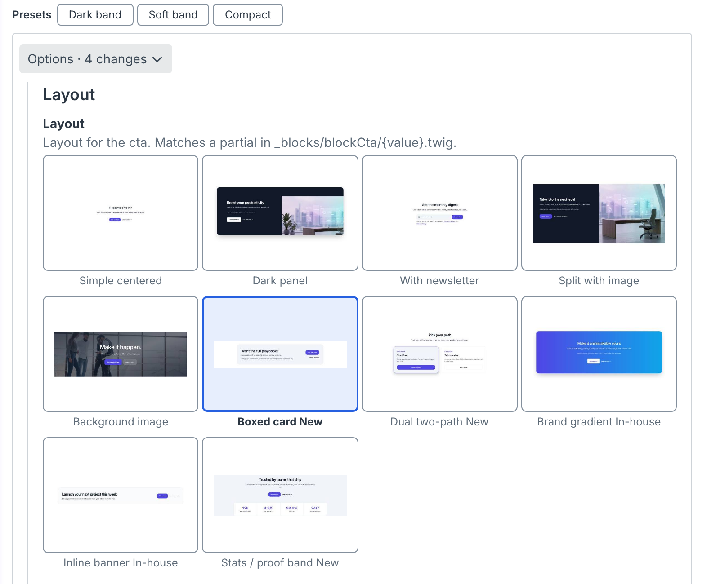
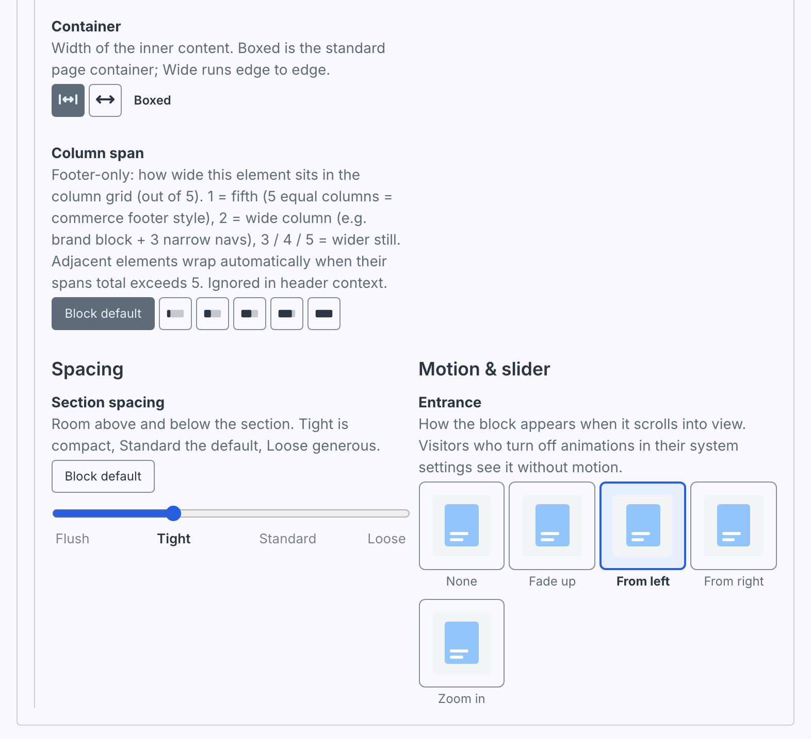
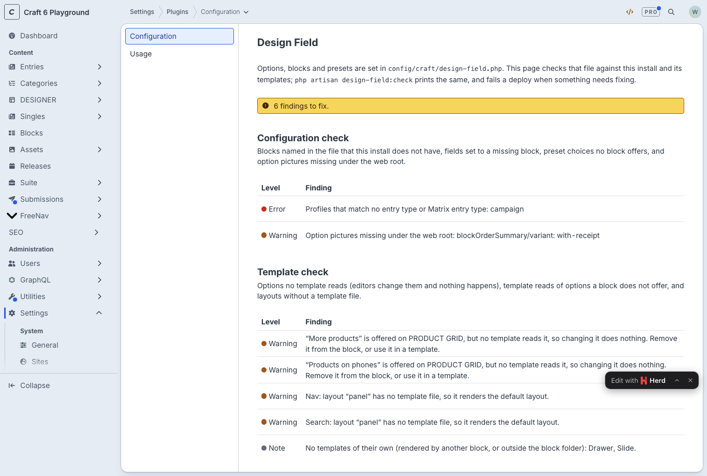
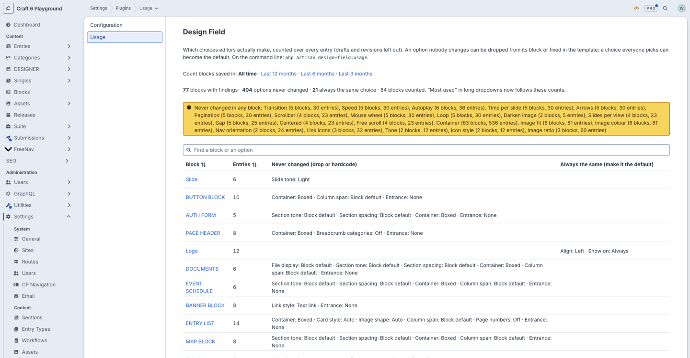
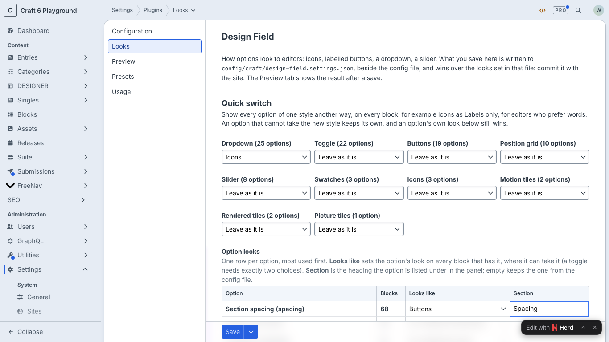
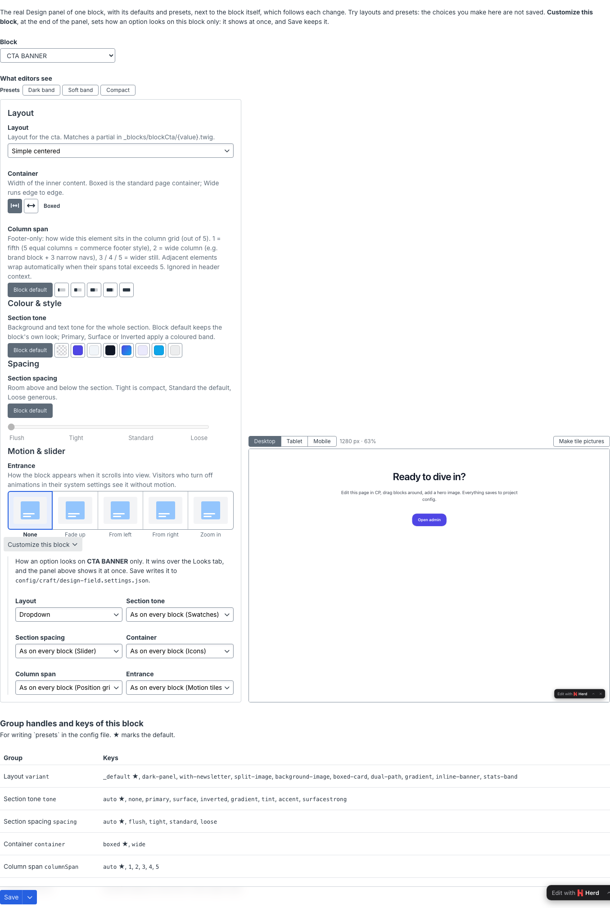
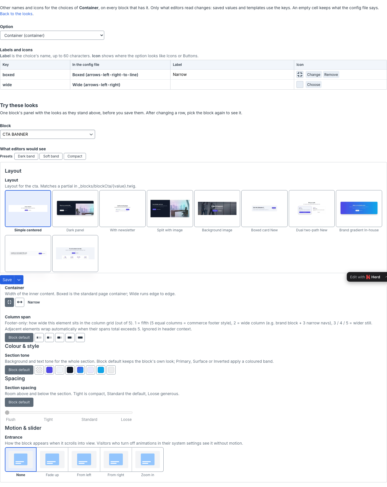
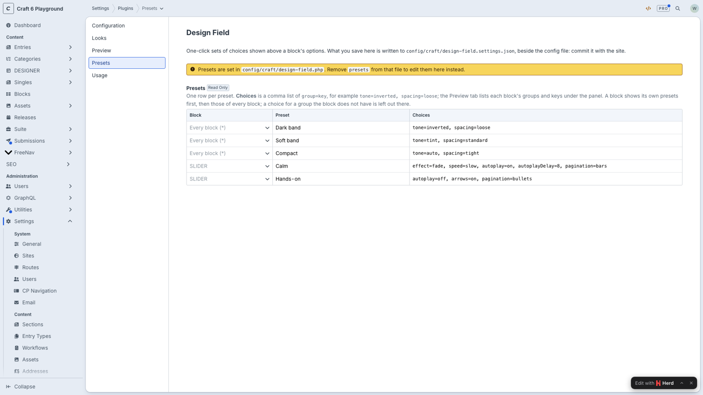
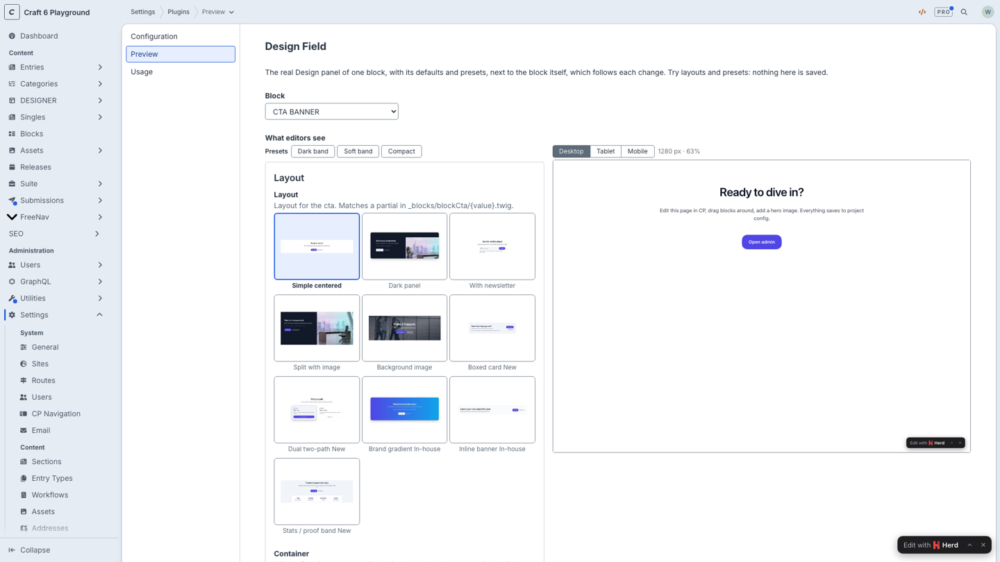

# Design Field for Craft CMS 6

One field for every design option of a block. Tone, spacing, layout, columns, alignment, card style: instead of a Button Group, a Dropdown and a Lightswitch per option per block, each block gets one compact **Design** panel.

- Editors pick from **named choices**: colour swatches, picture tiles of each layout, sliders for scales, position grids, buttons and dropdowns.
- Options **show only when they apply**: a setting the chosen layout does not use is hidden.
- The field stores **keys** (`{"tone":"surface","columns":"4"}`), never CSS. What a key means lives in a config file and your templates, so Tailwind sees every class and nobody can type a stray one.
- One reader, `craft.designField.of(block)`, works for the Design field, for the old option fields it replaces, and for showcase mock data.
- Coding agents read and write the field through Craft's own MCP server, with every option and its choices in the schema.





## Which version

| Craft CMS | Design Field | Branch |
|---|---|---|
| 6 | 2.x (beta) | [`2.x`](https://github.com/WMD-hosting/craft-design-field/tree/2.x) |
| 5 | 1.x | [`main`](https://github.com/WMD-hosting/craft-design-field/tree/main) |

Design Field 2 is a beta, as Craft 6 is. The field, its panel, the templates API, the condition rule, the console commands, the MCP schema and the [settings page](#the-settings-page) are in. These parts of 1.x are **not in 2.x yet**:

- on the settings page: the tables for groups, options and profiles (they are the config file), a look for one block only, other labels and icons for an option's choices, and Tidy up, which stays on 1.x;
- the tools that move a Craft 5 site's option fields onto the field (`import`, `adopt`, `migrate`). Run those on Craft 5 with 1.x.

## Price

Free, with every feature.

## Requirements

Craft CMS 6.0.0-beta.2 or later, PHP 8.5 or later.

## Install

```bash
composer require wmd/craft-design-field:^2.0@beta
php artisan craft:plugin:install design-field
```

## Start here

1. **Write the config file**, `config/craft/design-field.php`, with the options your blocks share and which block shows which (see Configuration):
   ```php
   return [
       'groups' => [
           'tone' => ['label' => 'Section tone', 'options' => ['plain' => 'bg-white', 'dark' => 'bg-slate-900 text-white'], 'auto' => 'Block default'],
           'spacing' => ['label' => 'Section spacing', 'options' => ['tight' => 'py-8', 'normal' => 'py-16', 'loose' => 'py-24'], 'default' => 'normal'],
       ],
       'profiles' => ['*' => ['tone', 'spacing']],
   ];
   ```
2. **Add the field.** Create a field of type *Design* and add it to your block entry types (or any entry type).
3. **Read it in the template.** On the block's outer element:
   ```twig
   
   <section class="{{ design.classes('tone', 'spacing') }}">…</section>
   ```
4. **Tailwind only:** Tailwind builds only the classes it finds in your files. Add the config file as a source in your main CSS (`@source "../../config/craft/design-field.php";`, path from that file), or keep class strings in token files that Tailwind already scans.

## Concepts

- A **group** is one choice: `tone`, `spacing`, `columns`. Its **options** come from a token file (`config/designtokens/{name}.json`, the Design Tokens plugin format) or are listed inline.
- A **profile** says which groups a block shows, and is picked per element, most specific first: `field:type` for a nested entry in one builder (`pageBuilder:blockTeam`), then the entry type handle, then `*`. A profile chosen in the field settings overrides the matching.
- A profile can override a shared group for its block (`'columns' => ['default' => '4']`), or define a group of its own, typically the block's **layout list** (`'variant' => ['options' => [...]]`).

## Configuration

The configuration is one file, `config/craft/design-field.php`:

```php
return [
    'groups' => [
        'tone' => [
            'label' => 'Section tone',
            'instructions' => 'Background and text tone for the whole section.',
            'tokens' => 'accent',                    // config/designtokens/accent.json
            'auto' => 'Block default',               // adds an `auto` option: the template decides
            'input' => 'swatches',
            'optionMeta' => ['primary' => ['swatch' => '#4f46e5']],
        ],
        'columns' => [
            'options' => ['2' => ['label' => '2'], '3' => ['label' => '3'], '4' => ['label' => '4']],
            'default' => '3',
            'input' => 'slider',
            'aliases' => ['three' => '3'],           // renamed keys keep working
        ],
    ],

    'profiles' => [
        'blockTeam' => [
            'variant' => [
                'label' => 'Layout',
                'input' => 'tiles',
                'options' => [
                    '_default' => ['label' => 'Grid', 'image' => '/design-field/blockTeam/_default.jpg'],
                    'cards' => ['label' => 'Cards', 'image' => '/design-field/blockTeam/cards.jpg'],
                ],
            ],
            'tone',
            'columns' => ['default' => '4', 'variants' => ['_default']], // shown only for the Grid layout
        ],
        '*' => ['tone'],
    ],
];
```

A config file written for 1.x works as it is: move it from `config/design-field.php` to `config/craft/design-field.php`. Token files stay in `config/designtokens/`.

### Group settings

| Key | |
|---|---|
| `label`, `instructions` | Shown in the panel |
| `tokens` / `options` | A token file name, or inline `key => classes` / `key => [label, icon, swatch, swatchText, percent, image, description, ...parts]` |
| `default` | Default key (first option, or `auto`) |
| `auto` | `true` or a label: adds an `auto` option; templates fall back with `keyOr()` |
| `aliases` | `old => new`, so renaming a key never breaks saved entries |
| `input` | `buttons`, `select`, `swatches`, `tiles`, `position`, `slider`, `toggle` (default: buttons when they fit, else select). `toggle` is a switch for a group with exactly two options, the first being "off" |
| `iconsOnly` | Buttons show only their icon, with the label read out |
| `columns` | Cells per row for `position` (default: one row, or the shape a position set's keys name) |
| `showIf` / `variants` | Show the group only when another group has one of these keys; `variants` is short for `showIf: {variant: [...]}` |
| `optionMeta` | Adds `label`, `icon`, `swatch`, `swatchText`, `percent`, `image`, `description` or `sample` to options defined elsewhere (token files, generated config) |

Option extras:

- `icon` is a Craft icon name or inline SVG, drawn in the button in the text colour.
- `swatch` is any CSS colour or gradient, or two colours joined by `|` (`#4f46e5|#0ea5e9`) for a chip split on the diagonal.
- `swatchText` is a text colour, drawn as "Aa" on the swatch so editors see the pair.
- `percent` is a width (`75`, `75%` or `0.75`), drawn as a bar filled that far beside the choice's name.
- `image` is a URL.
- `sample` is a CSS font size, shown as an "Aa" button so text sizes compare at a glance.

### Changing a group everywhere, or for one block

```php
'groupOverrides' => [
    'columns' => ['input' => 'buttons'],                 // every block
],
'profileOverrides' => [
    'blockTeam' => ['columns' => ['input' => 'slider', 'default' => '4']], // only Team
],
```

They take any group setting (`input`, `label`, `default`, `optionMeta`, `variants`...). Changing the input changes only how the choice looks; saved values stay.

### Looks

**Sliders** (`'input' => 'slider'`) step through the options in order, with every stop named under the track and Block default as its own button.

**Position grids** (`'input' => 'position'`) are square cells, `columns` to a row, with Auto or Block default on its own row above them. Keys that name a complete position set lay themselves out without `columns`, in grid order whatever order they are listed in: a nine-point grid (`top-left`, `top`, `top-right`, `left`, `center`, `right`, `bottom-left`, `bottom`, `bottom-right`), the four corners, a row (`left`/`start`, `center`, `right`/`end`) or a column (`top`, `middle`, `bottom`). `topLeft`, `top_left`, `left top` and `tl` are read the same way.

**Motion tiles** show animation choices (entrance, slide transition) as small cards that play their motion on hover and on keyboard focus; they stay still when the editor's system asks for reduced motion. Entrances: `fade`, `fade-up`, `fade-down`, `from-left`, `from-right`, `zoom-in`, `zoom-out`, `flip-in`, `blur-in`. Transitions (two slides): `slide`, `crossfade`, `fade-through`, `cube`, `coverflow`, `flip`, `cards`, `creative`. A choice plays the preset its key names, or the one it sets as `'motion' => 'crossfade'`. The tiles only suggest the motion; the site plays the real one.

**Rendered tiles** draw each choice as a small card with the site's own stylesheet and brand, so Corner radius and Card style show the brand's real radius, border and shadow. A choice's classes come from its `preview`, or with `'preview' => true` on the group from its token value, or for tokens with several parts from the parts you name (`'preview' => ['bg', 'text']`); `previewBase` adds classes every tile shares. Set `previewStylesheet` (the URL of the site's built CSS) and `previewAttributes` (e.g. `['data-brand' => 'default']`) in the config file; without a stylesheet the tiles fall back to buttons.

### Tile pictures

Layout options show as **picture tiles** when each layout has a picture. A picture comes from the config (`'image' => '/design-field/blockCta/split.jpg'`), or from a file at `tileImages` (default `/design-field/{type}/{key}.jpg` under the web root). A picture whose file is missing is left out. Hovering a tile, or reaching it with the keyboard, shows the picture at its real size.

**Make tile pictures** (settings page, Preview tab, above the block) makes the missing ones in the browser: each layout loads in a hidden frame through `blockPreviewUrl`, is drawn to a 480 px JPEG (modern-screenshot, MIT, shipped with the plugin) and saved to `tileImages`. Nothing to install on the server. With none missing, it offers to make them all again. The pictures show a saved block of that type, as the preview does. Set `tileSkip` to a CSS selector for things on the preview page that are not part of a block (a dev toolbar, an accessibility badge). Pictures are site files: commit them with the site. The button shows for a block with a layout list, where `blockPreviewUrl` and `tileImages` are set and admin changes are allowed.

### Sections

Blocks with many options read better with headings. Give options a section and the panel lists them under it (options without one come first; a section whose options the current layout all hides disappears):

```php
'sections' => [
    'variant' => 'Layout', 'columns' => 'Layout',
    'tone' => 'Colour & style', 'spacing' => 'Spacing',
    'motion' => 'Motion & slider',
],
```

The map applies to every option with the handle, including a block's own lists; a group's `section` key (or `groupOverrides`) works too.

### View mode and option layout

Field settings:

- **View Mode**: **As a panel** (every option open, the default), **As a summary** (one line of what differs from the defaults, with **Edit** to open the panel) or **Collapsed** (a closed section with the number of changes). A summary or collapsed panel starts open on a new element. One profile can use another mode than the field with `'_view' => 'panel'` in its config.
- **Option Layout**: **In sections** (the default), **Sections side by side** or **Inline**.
- **Profile**: the element's own (its type), or one named profile for every element that has the field.

### Presets

A preset is a named set of choices shown as a button above a block's options. Clicking it sets its choices in the panel in one change; the editor can still change each one afterwards, and only the choices are saved.

```php
'presets' => [
    '*' => [                                        // every block
        'Dark band' => ['tone' => 'inverted', 'spacing' => 'loose'],
        'Compact' => ['spacing' => 'tight'],
    ],
    'blockHeroSlider' => [                          // this block, listed first
        'Still hero' => ['variant' => '_default', 'autoplay' => 'off'],
    ],
],
```

Presets can also be edited on the settings page (Presets tab), which saves them to `config/craft/design-field.settings.json`; a `presets` key in the config file wins over that file.

A block shows its own presets first, then the `*` ones; its own wins when both use the same name. A preset sets only the groups the block has, and is hidden when none apply, so one `*` list serves every block.

## The settings page



**Settings → Plugins → Design Field** (admins only; a Design field's settings link to it). Groups, options and profiles stay in the config file. What the page saves, it saves to site files, and only where admin changes are allowed; everywhere else it opens read only.

The **Looks** and **Presets** tabs, and **Customize this block** on the Preview tab, write `config/craft/design-field.settings.json`, beside the config file. It holds only what they edit (`inputs` and `presets`; each save keeps the parts it does not edit), is laid over `design-field.php` when the configuration is read, and belongs in the repository like the config file: it deploys with the code. Delete the file to go back to the config file alone. If it is not valid JSON (a merge conflict left in it), none of it applies and the configuration check says so.

- **Looks**: how options look to editors. **Quick switch** shows every option of one style another way on every block (Icons as Labels only, for editors who prefer words); an option that cannot take the new style keeps its own. **Option looks** has one row per option, most used first: its look on every block that has it, and the section heading it is listed under. A look saved here wins over the looks in the config file (`inputs`, `groupOverrides`, `profileOverrides`). A look for one block only is set on the Preview tab (**Customize this block**). Order, last wins: config file, quick switch, option looks, this block. **Labels and icons** opens one option's choices: another name and another icon (Craft's icon picker) for each, on every block, so Tab size can read S · M · L instead of "Aa" samples with the Labels only look. An empty cell keeps what the config file says; only what editors read changes, saved values and templates use the keys (`inputs.meta`). **Try these looks** shows one block's panel with the looks as they stand in the form, before a save: it follows the quick switch at once, and a changed row after the block is picked again.
- **Presets**: one row per [preset](#presets): the block (or every block), its name, and its choices as `group=key, group=key`. A save is refused, with the reason, when a choice names a group or key no block has. When `design-field.php` has a `presets` key, that file wins and the tab shows its presets read only.

- **Configuration**: what `design-field:check` prints. The configuration check (blocks in the file this install does not have, fields set to a missing block, preset choices no block offers, option pictures missing under the web root) and the [template check](#template-check), one row per finding.
- **Preview**: the real Design panel of any block, with its defaults and presets. Layouts show and hide their options and presets apply; the choices made in it are never saved. The panel ends with **Customize this block**: one dropdown per option with the looks it can take on this block, for a look on this block only (a long list as a dropdown here, buttons everywhere else). The panel shows a look as soon as it is picked, before anything is saved; **Save** then writes the looks of this block to the settings file (`inputs.profiles`), where admin changes are allowed. "As on every block" removes the block's own look. Under the panel, the block's group handles and keys, for writing `presets`. With `blockPreviewUrl` in the config file, the block itself renders next to the panel and follows every change, drawn at a real desktop (1280), tablet (768) or mobile (375) width and scaled to fit, so its breakpoints are the device's:

  ```php
  'blockPreviewUrl' => '/_design-field/block?type={type}&design={design}',
  ```

  `{type}` is the block's entry type handle and `{design}` the panel's choices as JSON (option handle => key). [`examples/block-preview.twig`](examples/block-preview.twig) is a page for it, with the route: it shows the newest live block of that type and sets the choices for that render only. Without `blockPreviewUrl` the tab shows the panel alone. **Make tile pictures** is on this tab too: see [Tile pictures](#tile-pictures).
- **Usage**: the [usage report](#usage-report), run when you ask for it because it reads every entry. One row per block: the options nobody changed from the default, and the ones where every entry picked the same choice. **Count blocks saved in** limits it to the last 12, 6 or 3 months; the table can be searched and sorted. A run over all time also refreshes the **Most used** counts.













## Templates

```twig
   {# profile name is the fallback for mock maps #}

<section class="{{ design.tone.get('bg') }} {{ design.tone.get('text') }} {{ design.spacing }}">
  <div class="{{ design.container }}">

  {# `auto` or unset: this layout's own default #}
  {# the same, for the option's classes #}
...
{{ design.classes('tone', 'spacing') }}             {# joined classes of those groups #}
```

`block.design` works too when the block has the field. `craft.designField.of()` also reads plain mock maps, leniently: values outside a group's options pass through unchanged. A group that is not configured reads as empty, so removing one never breaks a page.

To let the layout choice live in the field, read `block.design.variant.key` in your block dispatcher.

## Fields that show for some layouts only

A block's other fields often belong to one or two of its layouts: a pricing block's "Included in every plan" strip is only there for the Plan cards layout. The Design field brings a condition rule for that, **Design → Variant**.

In the entry type's field layout, open a field's settings and add the rule under its Entry Condition: *Design → Variant is one of* (or *is not one of*, *has a value*, *is empty*) and the layouts that use the field. The field then shows only while one of them is picked. Craft checks the condition each time it refreshes the form, against the choices in the open editor.

- The rule offers the layouts of the entry type's profile, in panel order. A new entry type is offered every profile's layouts until it is saved.
- A block that never picked a layout is on the default one (`_default`). A block without layouts matches only *is empty*.
- It is offered where a condition tests an element (field layout conditions), not where one filters a query.
- The stored rule is `wmd\designfield\fields\conditions\DesignVariantConditionRule` with `operator` and `values`, the same as on Craft 5, so a project config written there keeps its conditions.

A database that applied such a project config before the plugin had the rule dropped the conditions from its stored layouts (the YAML keeps them). Run `php artisan craft:project-config:apply --force` once after updating.

## Template check

Options and the templates that render them, checked against each other: options a block offers that no template reads (editors change them and nothing happens), template reads of options a block does not offer (always the default), layout options without a template file, and template files no layout option reaches. It also runs the configuration check.

```bash
php artisan design-field:check          # exit code 1 when there is something to fix
php artisan design-field:check --json
```

It reads `design.x`, `design.has('x')`, `design.get('x')`, `design.classes('x', …)`, `craft.designField.of(block).x` and `block.design.x`, follows `include`, `embed`, `extends`, `import` and `from` with fixed paths, and counts option names quoted in your PHP as read. It looks in `resources/views` (or `templates`) and the PHP under `app/`; set `templateCheck` in the config file to change that:

```php
'templateCheck' => [
    'blocks' => '_blocks/{type}',          // a block's templates; {type} is the entry type handle
    'everyBlock' => ['_blocks/_render'],   // rendered for every block (the dispatcher)
    'code' => ['app'],                     // PHP that reads options too
],
```

## Schema for agents and tools

The option model as data, so coding agents and tools use the right handles and keys:

```bash
php artisan design-field:schema                          # JSON: every block, its options (handle, label, look, default, section, choices) and presets
php artisan design-field:schema --markdown               # a compact reference; options the same on several blocks are listed once
php artisan design-field:schema --agents=AGENTS.md       # writes that reference into the file between <!-- design-field:start/end --> markers
php artisan design-field:schema --agents=AGENTS.md --check   # CI: exit code 1 when the file is out of date
```

The rest of the file is left as it is; run it again after changing the configuration.

### MCP

Agents connected to Craft's own MCP server read and write a Design field as an object of option handle => choice key, `{"tone": "dark", "spacing": "loose", …}`. Nothing to set up:

- `elements_field_schema` describes the field as an object with one property per option of that block, each limited to its choice keys, with its label and default. A switch is its two keys (the description says which one is on).
- `elements_get` returns the choice of every option the block has.
- `elements_update` takes the same object, on the block itself or inside the Matrix field's input (`{"pageBuilder": {"entries": [{"blockCta": {"id": 12, "design": {…}}}]}}`; without `id` the block is added).

To change options, send back the whole object you read with one key changed. A partial object resets the options it leaves out to their defaults. An option the block does not have, a key that is no choice of its option and a value that is not an object are refused before anything is saved, with a message that names the option.

## Usage report

```bash
php artisan design-field:usage
php artisan design-field:usage --types=blockTeam --all
php artisan design-field:usage --json
php artisan design-field:usage --months=12   # a yearly review: only blocks saved in the last year
```

The counts also order **long dropdowns** (ten choices or more): the three most picked choices for that block type come first, under **Most used** (a block type with no picks for that option yet uses the counts across the site). The counts come from a queue job and are kept for a day.

The settings page shows the same report on its **Usage** tab. Per block, it shows the options editors never changed from the default (drop them from that block, or hardcode them in the template), options where every entry picked the same choice (make it the default), and layouts nobody uses. Blocks with fewer than `--sample` entries (default 5) are marked as hints.

## Choices per entry

Some choices only make sense for some entries: a "list the entries from this field" option should offer the fields the page has, not every field in the install. Before a panel is drawn, the plugin dispatches `wmd\designfield\events\DefinePanelGroups` with the element being edited and its options. Replace an option with `withHidden()` to leave choices out of the picker:

```php
use Illuminate\Support\Facades\Event;
use wmd\designfield\events\DefinePanelGroups;

Event::listen(DefinePanelGroups::class, function (DefinePanelGroups $event) {
    $group = $event->groups['sourceField'] ?? null;
    if ($group === null) {
        return;
    }
    // Keep the choices already hidden for this block.
    $event->groups['sourceField'] = $group->withHidden([...$group->hidden, 'legacyField']);
});
```

Only the picker changes: every option stays valid, so stored values, presets and templates are unaffected, and a block that already has a hidden choice still shows it.

To leave a whole option out of one entry's panel, add its handle to `$event->hiddenGroups`. It keeps its stored value, and options that depend on it still read it. `$event->keys` holds the current choices and `$event->element` the element.

On Craft 5 this was the Yii event `Design::EVENT_DEFINE_PANEL_GROUPS`.

## Starter stylesheet

`` in the site layout adds the plugin's small starter stylesheet to the page's head: the entrance animations and plain-CSS classes for tone, spacing, container and alignment. Recolour it with custom properties: `:root { --df-brand: #0f766e; }`.

## GraphQL

The field resolves to a JSON string of `group => key`, and accepts the same JSON in mutations.

## Coming from Craft 5

Craft 6 sites are new installs, so there is no in-place upgrade from 1.x. What carries over:

- **The config file**, as it is, at its new path `config/craft/design-field.php`. Options that 1.x kept in the settings tables (project config) have to be written into the file first.
- **Stored values**: the field stores the same JSON, so content imported from a Craft 5 site reads the same.
- **Templates**: `craft.designField` has the same API.
- **Conditions**: the Design → Variant rule has the same class name and stored config.
- **Console commands**: `craft design-field/check` is now `php artisan design-field:check`, and likewise `schema` and `usage`.
